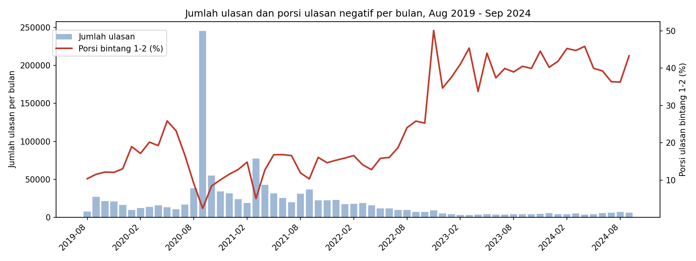
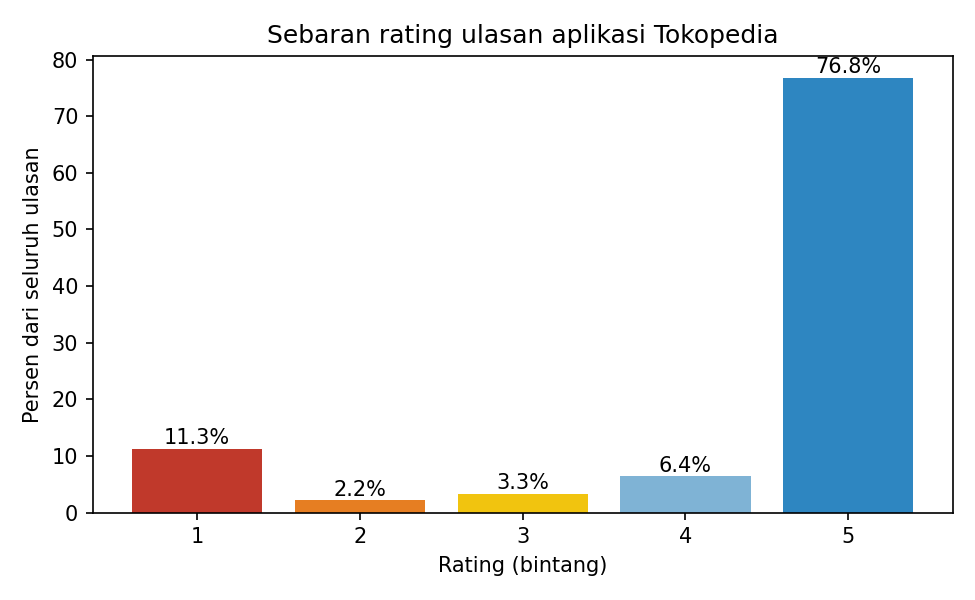
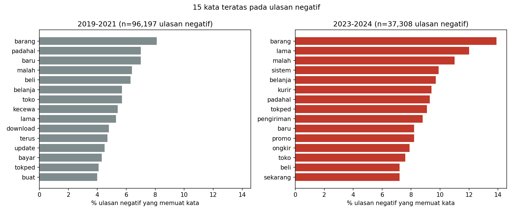
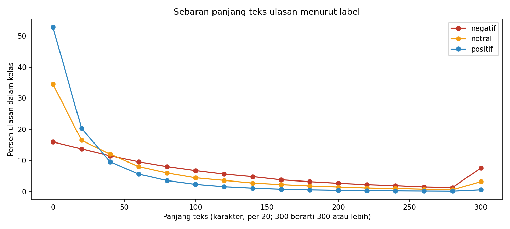
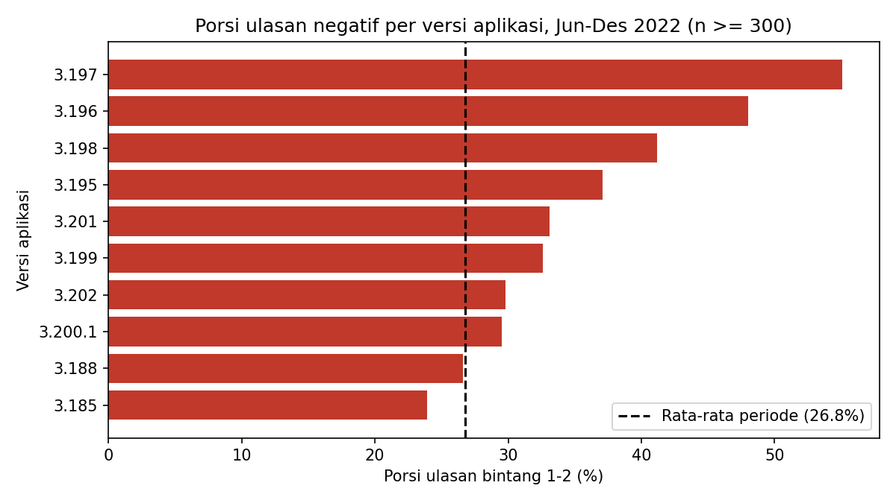

# Analisis Perubahan Porsi Ulasan Negatif, Tema Keluhan, dan Klasifikasi Ulasan pada Aplikasi Tokopedia 2019–2024
## Kelompok 3

**Mata kuliah:** Mahadata (Big Data)

## 1. Identitas Kelompok

| No | Nama | NIM |
|----|------|-----|
| 1 | Hanifah Hasanah | 123140082 |
| 2 | Mega Zayyani | 123140180 |
| 3 | Fanisa Aulia Safitri | 123140121 |
| 4 | Afrilia Dwi Amnesti | 123140079 |

## 2. Latar Belakang & Perumusan Masalah
 
### Latar Belakang
 
Ulasan pengguna di Google Play Store adalah sumber umpan balik yang terbuka dan berjumlah sangat besar bagi aplikasi *marketplace*. Pada aplikasi Tokopedia, ulasan yang terkumpul selama 2019–2024 mencapai lebih dari 1,19 juta baris dengan ukuran ±428 MB, sehingga pengolahannya membutuhkan pendekatan Big Data (Apache Spark) dan tidak praktis dilakukan dengan pustaka konvensional.
 
Hasil eksplorasi awal menunjukkan perubahan yang menarik: jumlah ulasan per tahun turun tajam dari 495.939 (2020) menjadi 46.357 (2023), sementara porsi ulasan bintang 1–2 naik dari 7,9% menjadi 40,2%. Perubahan ini perlu ditelusuri: kapan tepatnya porsi ulasan negatif berubah, keluhan apa yang menjadi penyebab utamanya, dan apakah ulasan negatif dapat dikenali secara otomatis dari teksnya.
 
### Perumusan Masalah
 
1. Kapan dan seberapa besar porsi ulasan negatif berubah? Perubahan jumlah ulasan per bulan ikut diperiksa agar kenaikan porsi tidak salah ditafsirkan. Versi aplikasi diperiksa sebagai petunjuk tambahan, dengan catatan keterangan versi kosong pada sekitar sepertiga data.
2. Tema keluhan apa yang dominan sebelum dan sesudah masa kenaikan porsi ulasan negatif?
3. Seberapa akurat model mengenali ulasan negatif dari teks, diukur dengan macro-F1?

---
 
## 3. Tujuan Utama Proyek
 
1. Mengetahui tema keluhan yang paling dominan serta waktu munculnya. 
2. Menjadi dasar untuk menentukan prioritas perbaikan fitur dan layanan.
3. Menyediakan model yang dapat mengenali ulasan negatif secara otomatis sebagai bentuk peringatan dini.
---
 
## 4. Gambaran Dataset & Pra-Pemrosesan Big Data
 
### 4.1 Gambaran Dataset
 
**Sumber:** Kaggle, *E-Commerce Ratings and Reviews in Bahasa Indonesia*, dikumpulkan dari Google Play Store (Bahtiar et al., 2023).
 
| Aspek | Nilai |
|-------|-------|
| Berkas | `raw_review_googleplay.csv` |
| Jumlah baris | 1.192.500 ulasan |
| Jumlah kolom | 11 |
| Periode | 24 Agustus 2019 – 18 September 2024 |
| Ukuran berkas | ±428 MB (CSV) |
| Cakupan wilayah | Tidak ada kolom wilayah, ulasan global dari Google Play |
 
| Kolom | Tipe | Keterangan |
|-------|------|------------|
| `reviewId` | Pengenal | ID unik ulasan |
| `userName` | Kategorik (anonim) | Hampir seluruhnya "Pengguna Google" |
| `userImage` | URL | Foto profil, tidak dipakai |
| `content` | Teks | Isi ulasan, bahan utama model |
| `score` | Ordinal (1–5) | Rating, dasar pembuatan label |
| `thumbsUpCount` | Numerik (cacah) | Jumlah jempol pada ulasan |
| `reviewCreatedVersion`, `appVersion` | Kategorik | Versi aplikasi |
| `at` | Waktu | Waktu ulasan dibuat |
| `replyContent`, `repliedAt` | Teks, waktu | Balasan dan waktu balasan dari pihak aplikasi |
 
### 4.2 Lingkungan dan Pemrosesan Big Data
 
- **Platform:** Google Colab, Python 3.13, PySpark/Spark 4.2.1 (mode lokal), pandas, matplotlib.
- **Pembacaan data:** CSV dibaca dengan Spark (opsi `multiLine`, tanda kutip dan *escape* `"`), lalu disimpan sebagai **Parquet** agar eksplorasi berikutnya lebih cepat (pemuatan awal sekitar 21 detik).
- **Cara menjalankan:** buka notebook `EDA_Kelompok3.ipynb` lewat tombol Colab, sesuaikan `ZIP_PATH` (lokasi `archive.zip` di Google Drive) atau atur `CSV_PATH`, lalu jalankan semua sel berurutan. Dataset tidak disertakan di repositori. Gambar hasil visualisasi dibuat ulang oleh notebook ke folder `gambar/`.
### 4.3 Kualitas Data dan Penanganannya
 
| Masalah | Temuan | Penanganan |
|---------|--------|------------|
| **Data kosong** (`replyContent`, `repliedAt`) | 779.658 baris (65,38%) | Dibiarkan kosong; berarti ulasan tidak dibalas, bukan data hilang. Tidak dipakai sebagai fitur. |
| **Data kosong** (`reviewCreatedVersion`, `appVersion`) | 390.107 baris (32,71%) | Tidak diimputasi. Baris tetap dipakai; pada analisis per versi baris kosong dikeluarkan dan proporsinya dilaporkan (19,0% pada Jun–Des 2022). |
| **Data kosong: teks ulasan** (`content`) | 2 baris | Dibuang. |
| **Duplikat ID** (`reviewId`) | 0 | Tidak perlu penanganan. |
| **Duplikat teks** | 508.630 baris (42,7%); hanya 683.868 teks unik | Dipertahankan pada data `valid`, dihapus (disisakan satu) pada data `model`. |
| **Ulasan sangat pendek** (≤ 3 karakter) | 64.306 baris (5,4%) | Dibuang dari data `model`. |
| **Ulasan tanpa huruf** | 16.454 baris (1,4%) | Dibuang dari data `model`. |
| **Format dan rentang nilai** | 0 kegagalan konversi `score`, `thumbsUpCount`, `at`; 0 rating di luar 1–5 | Tidak perlu penanganan. |
| **Privasi** | `userName` "Pengguna Google" 99,83%; 0 ulasan berpola email; 1 ulasan berpola nomor telepon | `userName` dan `userImage` dibuang; URL, email, dan nomor telepon pada teks dihapus lewat regex. |
| **Pencilan** | Panjang teks dan `thumbsUpCount` berekor panjang (maksimum 1.014 karakter dan 2.795 jempol); lonjakan volume pada September 2020 (245.444 ulasan, porsi negatif 2,4%) | Tidak dibuang karena tetap ulasan yang sah; ditandai sebagai pencilan volume. |
 
### 4.4 Hasil Pembersihan yang berisi Dua Versi Data
 
| Tahap | Jumlah baris | % dari mentah |
|-------|-------------:|--------------:|
| Data mentah | 1.192.500 | 100,0 |
| Dibuang: teks kosong atau waktu/rating tidak valid | 2 | 0,0 |
| **Data `valid`** (untuk tren per bulan) | **1.192.498** | 100,0 |
| Dibuang: teks ≤ 3 karakter atau tanpa huruf | 69.487 | 5,8 |
| Dibuang: teks ganda (disisakan satu) | 464.865 | 39,0 |
| **Data `model`** (untuk pelatihan model) | **658.146** | 55,2 |
 
- **Label dari rating:** bintang 1–2 = negatif, 3 = netral, 4–5 = positif.
- **Sebaran label pada data `model`:** positif 73,4% (482.975), negatif 22,2% (146.268), netral 4,4% (28.903).
- **Kolom `content_clean`:** huruf kecil, spasi dirapikan, serta URL, email, dan nomor telepon dihapus.
### 4.5 Kendala dan Keputusan Pembersihan
 
**Kendala**
- Ukuran data dan teks multi-baris membuat pembacaan dengan pandas tidak praktis.
- Duplikasi teks sangat besar (42,7%): menghapusnya mengubah tren, sedangkan membiarkannya membuat teks yang sama muncul di data latih dan uji.
- Kelas tidak seimbang (rating 5 mendominasi, kelas netral hanya 4,4% pada data `model`).
- Satu bulan (September 2020) menyumbang ±245 ribu ulasan sehingga memengaruhi rata-rata tahun 2020.
- Tidak ada kolom wilayah, dan sepertiga baris tidak memiliki keterangan versi aplikasi.
- Label diturunkan dari rating, bukan dari penilaian isi teks, sehingga ulasan yang rating dan isinya tidak sejalan (misalnya sarkasme) dapat terlabel keliru.
**Keputusan**
1. Dua versi data dipakai karena tujuannya berbeda: `valid` untuk tren (duplikat tetap dihitung) dan `model` untuk pelatihan (tanpa teks ganda).
2. Kolom kosong tidak diimputasi.
3. Pencilan hanya ditandai, tidak dibuang.
4. Kolom identitas pengguna dibuang dan data pribadi pada teks dihapus.
5. Label netral (bintang 3) dipertahankan; metrik **macro-F1** dipilih untuk pemodelan karena kelas tidak seimbang.
6. Daftar kata henti memuat kata negasi dan kata umum (misalnya "tidak", "gak", "bagus") agar kata bertema lebih terlihat; akibatnya makna negasi tidak terbaca pada analisis frekuensi kata.
7. Porsi negatif pada data `model` (22,2%) lebih tinggi daripada pada data `valid` (13,5%) karena penghapusan duplikat lebih banyak membuang ulasan positif yang pendek dan berulang; angka dari kedua versi tidak boleh dibandingkan langsung.
---
 
## 5. Hasil Visualisasi
 
> Gambar dibuat oleh notebook dan tersimpan di folder `gambar/`. Ganti placeholder di bawah dengan gambar hasil run kelompok bila nama berkas berbeda.
 
### Visualisasi 1 Jumlah Ulasan dan Porsi Ulasan Negatif per Bulan
 

 
Diagram batang menunjukkan jumlah ulasan per bulan dan garis merah menunjukkan porsi ulasan bintang 1–2. Jumlah ulasan turun dari 495.939 (2020) menjadi 46.357 (2023), sedangkan porsi negatif naik dari 7,9% (2020) menjadi 19,9% (2022), 40,2% (2023), dan 40,9% (2024). Lonjakan tajam terlihat pada November 2022 (50,1%). Bulan dengan volume terbesar adalah September 2020 (245.444 ulasan, porsi negatif 2,4%).
 
### Visualisasi 2 Sebaran Rating
 

 
Rating sangat condong ke bintang 5 (76,8%), diikuti bintang 1 (11,3%), bintang 4 (6,4%), bintang 3 (3,3%), dan bintang 2 (2,2%). Ulasan negatif (bintang 1–2) berjumlah 13,5% dari seluruh ulasan. Ketidakseimbangan ini menjadi alasan penggunaan macro-F1 pada tahap pemodelan.
 
### Visualisasi 3 Kata Teratas pada Ulasan Negatif: Sebelum vs Sesudah Kenaikan
 

 
Membandingkan 15 kata teratas pada ulasan negatif periode 2019–2021 dan 2023–2024 (persen ulasan negatif yang memuat kata tersebut). Pada 2019–2021 muncul kata seperti *download*, *update*, dan *bayar*. Pada 2023–2024 muncul kata bertema logistik dan layanan seperti *kurir*, *pengiriman*, *ongkir*, *promo*, dan *sistem*, sementara *barang* dan *lama* meningkat (masing-masing 8,1% menjadi 13,9% dan 5,3% menjadi 12,0%). Ini merupakan temuan awal berbasis frekuensi kata, belum analisis topik.
 
### Visualisasi 4 Panjang Teks Ulasan Menurut Label
 

 
Ulasan negatif cenderung jauh lebih panjang daripada ulasan positif: median 78 karakter (rata-rata 112,8) untuk negatif, 38 (69,9) untuk netral, dan 17 (35,7) untuk positif. Panjang teks berpotensi menjadi sinyal yang berguna bagi model klasifikasi.
 
### Visualisasi 5 Porsi Ulasan Negatif Menurut Versi Aplikasi (Jun–Des 2022)
 

 
Menampilkan 10 versi aplikasi dengan porsi negatif tertinggi (minimal 300 ulasan) pada masa kenaikan. Versi 3.197 memiliki porsi tertinggi (55,1%; 1.841 ulasan), diikuti 3.196 (48,0%; 2.177 ulasan) dan 3.198 (41,2%; 869 ulasan). Perlu diingat bahwa 19,0% baris pada periode ini tidak memiliki keterangan versi, sehingga hasil ini hanya menggambarkan sebagian data dan belum membuktikan hubungan sebab-akibat.
 
---
 
## 6. Lisensi & Sitasi
 
Dataset ulasan aplikasi Tokopedia yang digunakan pada penelitian ini bersumber dari data publik oleh Bahtiar et al. (2023) melalui teknik *web scraping* Google Play Store.
 
> Bahtiar, S. A., Dewa, C., & Luthfi, A. (2023). Comparison of Naïve Bayes and Logistic Regression in Sentiment Analysis on Marketplace Reviews Using Rating-Based Labeling. *Journal of Information Systems and Informatics*, 5(3), 915–927. https://doi.org/10.51519/journalisi.v5i3.539
 
Pengumpulan data ulasan dilakukan menggunakan pustaka `google-play-scraper` pada rentang tahun 2019 hingga 2024 (Bahtiar et al., 2023).
 
Artikel tersebut didistribusikan dengan lisensi [Creative Commons Attribution 4.0 International (CC BY 4.0)](http://creativecommons.org/licenses/by/4.0/), yang mensyaratkan atribusi kepada pencipta asli. Ketentuan penggunaan berkas data `raw_review_googleplay.csv` mengikuti halaman dataset di Kaggle.